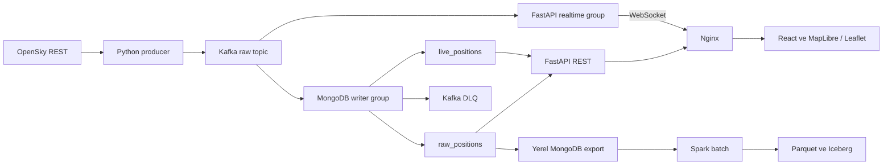
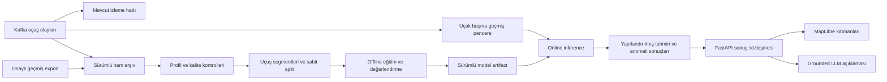

# Capstone Architecture

## Mevcut sistem

Phase 0 referansı `main` üzerindeki `cf3b28e`. Çalışma zamanı doğrulamasının kapsamı [audit raporundadır](REPOSITORY_AUDIT.md#existing-functionalities).

- Uçuş olayları `aircraft.positions.raw.v1` üzerinden iki bağımsız consumer group'a gider. `flight-mongodb-writer-v1` geçmiş ve son durum belgelerini yazar. `flight-realtime-gateway-v1` WebSocket yayını yapar. Yazar, iki MongoDB yazımı sonrasında offset'i commit eder. Kalıcı bozuk olayda commit, DLQ tesliminden sonradır. Bu düzen tekrar okuma ile toparlanmayı destekler. [MongoDB writer](../../consumer/mongodb_consumer.py#L495) · [Realtime gateway](../../backend/app/kafka_gateway.py#L79)
- Tarayıcı `live_positions` tabanlı REST snapshot ile başlar ve bağlantı geri geldiğinde snapshot ile eşitlenir. `raw_positions` seçili uçağın geçmiş rotasını sağlar. Kafka ve MongoDB erişimi servisler üzerinden gerçekleşir. [Frontend feed](../../frontend/src/hooks/useAircraftFeed.ts#L140) · [Backend sorguları](../../backend/app/database.py#L27)
- Spark, yerel export'u batch olarak işler. Bronze seçilmiş alanları korur, Silver kalite filtresi uygular, Rejected red nedenlerini taşır ve Gold saatlik özetler üretir. Iceberg tablo başına snapshot sağlar. Export ve refresh bu başlangıç referansında script'lerle başlatılıyor. [Spark rehberi](../../spark/README.md) · [Iceberg tablosu ve snapshot](../../spark/iceberg-README.md#oluşan-tablolar)

## Önerilen capstone mimarisi

Bu tasarım, araştırma kapsamı ve arşiv seçimi onaylandıkça ayrıntılandırılacak.

| Parça | Sorumluluk ve hata davranışı |
|---|---|
| Ham arşiv ve dataset | Asıl olay, kaynak zamanı ve veri kökenini saklar. Arşiv manifest'i checksum, kapsam ve gap kaydı taşır. Kalite ve türetme adımları yeni bir dataset sürümü üretir. Kayıp veya bozuk parça checksum ve offset ile araştırılır. [Profiling ve toplama planı](DATA_PROFILING_AND_COLLECTION_PLAN.md) |
| Offline model | Sabit train/validation/test split'leri ve yeniden çalıştırılabilir eğitim ayarları ile single-task ve multi-task modelleri karşılaştırır. Koşu sonucu, model sürümü ve başarısız deney kaydı saklanır. [Deney protokolü](EXPERIMENTS.md) |
| Online inference | İlgili uçak için son gözlemlerden eğitimle uyumlu pencere hazırlar. Geç, eksik ve sıra dışı zamanda gelen olaylar bir freshness/kapsam durumuyla raporlanır. Inference geçici olarak durursa mevcut canlı rotalar sunulabilir ve tahmin katmanı erişilebilirlik durumunu gösterir. |
| Sonuç sözleşmesi | Önerilen alanlar sonuç ve model sürüm kimliği, gözlem ve üretim zamanı, horizon, tahmin koordinatları, anomali skoru/eşiği ve veri tazeliği. Sonuçların tekrar işlenmesi, aynı model ve girdi kimliğine göre izlenebilir. |
| Demo ve açıklama | MapLibre gözlem, tahmin ve anomaliyi farklı katmanlarla gösterir. LLM, sonuç kimliği ve model sürümüne bağlı yapılandırılmış çıktıları açıklar. Yetersiz veri veya eski sonuç durumu kullanıcıya gösterilir. |

Replay ile doğrulanacak temel davranışlar aynı girdide offline/online pencere eşliği, yeniden başlatmada veri boşluklarının tespiti ve yük altında gecikme dağılımıdır. Uçuş takip uygulamasına etkiler `/health`, consumer lag ve REST/WebSocket davranışı üzerinden ölçülebilir. Inference'ın süreç ve depolama seçimi, inference yükü ve ihtiyaç netleştiğinde [karar kaydına](DECISIONS.md) alınacak.
