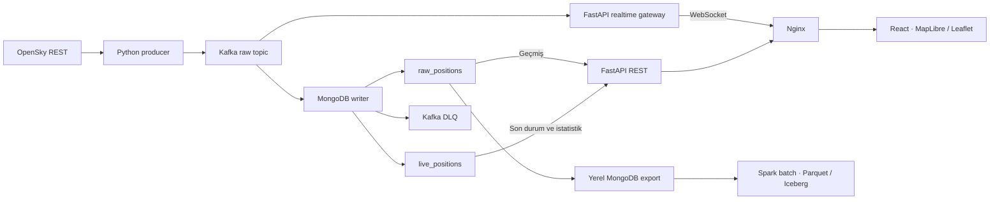

# Repository Audit Report

**Real-Time Aircraft Trajectory Prediction and Anomaly Detection Using Multi-Task Deep Learning**

26 Kasım 2026 · İncelenen commit `cf3b28e` · Dal `main`

## Executive Summary

Repository, bitirme projesinin **veri toplama, geçmiş konumları saklama ve canlı sonuçları görselleştirme** altyapısı olarak kullanılabilir. Canlı uygulama OpenSky → Kafka → MongoDB/FastAPI → React hattını kullanıyor. Spark ve Iceberg de mevcut. Bunlar MongoDB’den dışa aktarılan veriyi yerelde toplu işleyen ayrı bir analiz hattı oluşturuyor. [Canlı mimari](../../README.md#veri-akışı) · [Spark veri akışı](../../spark/README.md#veri-akışı)

En önemli veri bulgusu, yereldeki dört export’ta **4.620.879 satır ve 2.704.999 benzersiz `event_id`** bulunması. En eski ve en yeni gözlem arasındaki süre **3,39 gün**. Uçak başına birbirini izleyen farklı gözlem zamanlarının medyan farkı dört dosyanın her birinde **121 saniye**. Bu veri, dakika ölçeğinde bir trajectory prediction pilotu için aday. Uçuş segmentleri, anomali etiketleri ve farklı dönemlere genelleme kanıtı henüz eksik.

**Doğrulama.** 65 Python ve 6 frontend unit testi geçti. Frontend build’i ve statik Compose/Kustomize kontrolleri başarılı. Mock verili Playwright turunda 6 testten 5’i geçti. Mobil harita zemini yeniden yükleme senaryosu tek başına iki kez çalıştırıldığında bir kez geçti, bir kez aynı noktada başarısız oldu. Docker daemon’una erişilemediği için canlı entegrasyon doğrulanamadı. Denetim yerel ve salt okunur yürütüldü. Git çalışma ağacı temizdi.

## Repository Structure

| Yol | Mevcut sorumluluk |
|---|---|
| `producer/`, `flight_common/` | OpenSky sorgulama, state vector dönüşümü, mock olay üretimi, ortak loglama ve producer metrikleri. [OpenSky producer](../../producer/opensky_producer.py#L209) |
| `kafka/`, `consumer/` | Topic ve retention hazırlığı, MongoDB yazımı, hata kuyruğu ve uygulama verisi yedekleme/geri yükleme. [Kafka admin](../../kafka/admin.py#L44) · [MongoDB writer](../../consumer/mongodb_consumer.py#L334) · [Backup formatı](../../consumer/mongodb_transfer.py#L14) |
| `backend/app/` | REST sorguları, public uçak veri sözleşmesi, Kafka realtime consumer, WebSocket yayınları, sağlık ve metrikler. [API](../../backend/app/main.py#L324) · [Public sözleşme](../../backend/app/contracts.py#L1) |
| `frontend/` | Canlı tablo, arama, sistem durumu, MapLibre, Leaflet fallback, geçmiş rota ve Nginx proxy. [Uygulama](../../frontend/src/App.tsx#L86) · [Nginx](../../frontend/nginx.conf#L28) |
| `spark/`, `scripts/` | MongoDB export, PySpark batch işleri, Parquet ve Iceberg tabloları, snapshot ve HTML raporu. Git’te küçük bir fixture var. Yerel veri ve üretilen çıktılar `.gitignore` kapsamında. [Spark işleri](../../spark/jobs/iceberg_positions.py#L43) · [Git ignore](../../.gitignore#L35) |
| `compose*.yaml`, `k8s/`, `argocd/` | Release ve geliştirme Compose yapılandırmaları, frontend’e özel yerel override, Kubernetes ders manifestleri ve GitOps dağıtımı. [Compose](../../compose.yaml#L1) · [Kustomize](../../k8s/lesson-05/kustomization.yaml#L6) · [Argo CD](../../argocd/flight-data-pipeline-application.yaml#L13) |
| `tests/`, `frontend/e2e/`, `.github/workflows/`, `docs/`, `deliverables/` | Uygulama testleri, CI/release, işletim dokümanları ve staj sunumları. [CI](../../.github/workflows/ci.yml#L18) · [Tarayıcı testleri](../../frontend/e2e/smoke.spec.ts#L9) · [İşletim rehberi](../operations.md) |

## Technology Stack

| Katman | Kod ve yapılandırmada görülen teknoloji |
|---|---|
| Veri toplama ve işleme | Python 3.13.14, `requests`, `confluent-kafka`, `pymongo`, `prometheus-client`. Python servisleri hash doğrulamalı bağımlılık dosyaları kullanıyor. [Producer bağımlılıkları](../../producer/requirements.in#L1) · [CI kurulum adımları](../../.github/workflows/ci.yml#L23) |
| Mesajlaşma ve depolama | Apache Kafka Native **4.3.1**, tek düğüm KRaft. MongoDB Community **8.0.28**, kalıcı volume ve TTL index’leri. [Compose altyapısı](../../compose.yaml#L16) |
| API ve arayüz | FastAPI, Uvicorn, WebSocket, React **19.2.8**, TypeScript, Vite, MapLibre GL JS **6.0.0**, Leaflet **1.9.4**, Leaflet MarkerCluster ve Nginx. [Backend bağımlılıkları](../../backend/requirements.in#L1) · [Frontend lock dosyası](../../frontend/package-lock.json#L1) · [Frontend image](../../frontend/Dockerfile#L1) |
| Toplu analiz | PySpark, Parquet, yerel Iceberg Hadoop Catalog. Spark image’ı digest ile, Iceberg runtime paketi `iceberg-spark-runtime-4.0_2.13:1.11.0` ile sabitlenmiş. [Spark/Iceberg çalıştırıcısı](../../scripts/run-iceberg-local.sh#L31) |
| Dağıtım ve doğrulama | Docker Compose, Kubernetes/Kustomize, Argo CD, Prometheus, Grafana, pytest, Vitest, Playwright ve GitHub Actions. Release workflow’unda AMD64/ARM64 image, SBOM, provenance ve Cosign adımları tanımlı. [Monitoring](../../argocd/monitoring-application.yaml#L8) · [Release workflow](../../.github/workflows/release.yml#L72) |

## Current Architecture

MongoDB yazıcısı ve realtime gateway, Kafka’da farklı **consumer group** kimlikleri kullanıyor. Böylece bir taraf arşive yazarken diğer taraf aynı olayları tarayıcıya yayınlayabiliyor. Spark tarafı export dosyası okuyan `local[2]` batch işleriyle çalışıyor. İncelenen Compose, Kubernetes ve CI yapılandırmalarında Spark streaming consumer veya düzenli Spark çalıştıran bir iş tanımı bulunmadı. [Compose servisleri](../../compose.yaml#L95) · [Realtime consumer](../../backend/app/kafka_gateway.py#L79) · [Spark çalıştırıcısı](../../scripts/run-spark-local.sh#L34)

## End-to-End Data Flow

1. **Toplama.** Producer, OpenSky `/api/states/all` yanıtındaki konum vektörlerini tek uçak başına bir JSON olaya dönüştürüyor. Konumu bulunmayan veya kısa vektörler atlanıyor. Kafka mesaj anahtarı `icao24`. Producer `acks=all` ve idempotence ile gönderiyor, teslim sonucunu kontrol ediyor. Başarısız bir poll sonrası geçerli mesajların bir kısmı daha önce Kafka’ya ulaşmış olabilir. Aynı OpenSky snapshot’ını yeniden yükleyen kalıcı bir mekanizma görünmüyor. [Dönüşüm ve Kafka teslimi](../../producer/opensky_producer.py#L250) · [Poll döngüsü](../../producer/opensky_producer.py#L410)
2. **Kalıcı yazım.** MongoDB consumer önce `raw_positions` geçmiş belgesini, sonra `live_positions` son durumunu yazıyor. Kafka offset’i, yani mesajın işlendiği konum, iki işlem başarılı olunca commit ediliyor. Arada çökme olursa Kafka mesajı yeniden okunabilir. Aynı `event_id` için raw upsert ikinci belgeyi önler. Geçici Mongo hatalarında sınırlı retry uygulanır. Kalıcı bozuk mesajda offset, DLQ teslimi doğrulandıktan sonra ilerler. Bu tasarım **at-least-once + idempotent yazım** sağlar. Producer idempotence Kafka gönderim tekrarlarını, Mongo upsert ise consumer yeniden işlemelerini ele alır. [MongoDB upsert](../../consumer/mongodb_consumer.py#L334) · [Retry ve commit](../../consumer/mongodb_consumer.py#L461)
3. **Canlı yayın ve toparlanma.** Gateway, varsayılan 250 ms ve 500 mesajlık batch eşikleriyle `aircraft.batch` yayınlıyor. Tarayıcı ilk açılışta ve WebSocket yeniden bağlanınca REST snapshot alıyor. Canlı liste varsayılan olarak son 20 dakikayı gösteriyor. Uçak seçildiğinde arayüz geçmişten 120 noktaya kadar istiyor. API geçmişi `icao24` ile, en yeni ölçümden geriye doğru döndürüyor ve en fazla 1.000 noktaya izin veriyor. [Batch yayını](../../backend/app/kafka_gateway.py#L224) · [Frontend snapshot ve reconnect](../../frontend/src/hooks/useAircraftFeed.ts#L140) · [Geçmiş API’si](../../backend/app/main.py#L346) · [Harita geçmişi](../../frontend/src/App.tsx#L150)
4. **Toplu analiz.** Export script’i Kubernetes’teki MongoDB pod’undan `raw_positions` verisini Canonical Extended JSON satırları olarak okuyup gzip sıkıştırıyor. Spark, seçilmiş sütunları Bronze’a alıyor, kalite kurallarına göre Silver ve Rejected tablolarını oluşturuyor ve saatlik/kalite özetlerini Gold’a yazıyor. Incremental akış son `ingested_at` değerinden beş dakika geriye bakıyor ve Bronze’da bulunan `event_id` değerlerini tekrar eklemiyor. Bir tablo yazımı başarılı ve sonraki adım başarısız olursa katmanlar geçici olarak farklı snapshot’larda kalabiliyor. [MongoDB export](../../scripts/export-spark-raw-positions.sh#L42) · [Bronze append](../../spark/jobs/iceberg_batch_refresh.py#L55) · [Silver ve Rejected commit’leri](../../spark/jobs/iceberg_silver_refresh.py#L95)

## Data Sources and Data Schemas

- **Kaynak ve sampling.** OpenSky REST, uçakların işlenmiş konum vektörlerini sağlıyor. Varsayılan kapsam `global`, alternatif kapsam Türkiye ve yakın çevresini kapsayan bir bounding box. OAuth ile varsayılan bekleme 120 saniye. Kimliksiz kullanımda global için en az 900, Türkiye için en az 660 saniye uygulanıyor. Bekleme, fetch ve Kafka teslimi sonrasında başlıyor. HTTP 429 durumunda ayrı bir bekleme uygulanıyor. Bu yüzden poll ayarı, uçak başına sabit bir ölçüm aralığı vermiyor. Test amaçlı `mock_producer.py` aynı hatta `source=mock` olayları gönderebiliyor. [Polling ayarları](../../producer/opensky_producer.py#L27) · [Bekleme mantığı](../../producer/opensky_producer.py#L428) · [Mock olay](../../producer/mock_producer.py#L53)
- **Olay alanları.** `schema_version=1`, UUID `event_id`, `icao24`, `callsign`, koordinat, barometrik ve geometrik irtifa, hız, yön, dikey hız, `on_ground`, `position_source`, `category` ve zaman alanları bulunuyor. `observed_at` sırasıyla `time_position`, `last_contact` veya `api_time` üzerinden türetiliyor. Yeni OpenSky olaylarında `ingested_at` producer’ın olay oluşturma zamanı. Eski kayıtta alan yoksa consumer kendi zamanını verebiliyor. Bu alanlar fiziksel ölçüm zamanı, API zamanı ve sistem işleme zamanı için farklı anlamlar taşıyor. [Olay şeması](../../producer/opensky_producer.py#L265) · [Consumer zaman dönüşümü](../../consumer/mongodb_consumer.py#L171)
- **MongoDB ve public API.** Raw belgelerde `_id=event_id`, eski olaylarda `topic:partition:offset`. `live_positions` içinde `_id=icao24`. Raw geçmiş index’i `{icao24: 1, observed_at: -1}`. Public API ve WebSocket aynı alan projeksiyonunu kullanıyor. Bu projeksiyon `time_position`, `api_time`, `position_source` ve `schema_version` gibi veri kökeni alanlarını içermiyor. [MongoDB index ve kimlikleri](../../consumer/mongodb_consumer.py#L325) · [Public alanlar](../../backend/app/contracts.py#L1)
- **Saklama.** Kafka raw için varsayılan 48 saat ve partition başına 10 GiB, DLQ için 30 gün ve partition başına 1 GiB. Yeni topic’ler bir partition ve bir replica ile oluşturuluyor. MongoDB TTL, `ingested_at` üzerinden raw için 48 saat, live için 7 gün. Iceberg snapshot’ları yerel diskte bulunuyor. İncelenen işlerde uzun vadeli arşivleme takvimi, snapshot saklama politikası veya arşiv eksiklerini tespit eden bir kontrol görülmedi. [Kafka retention ve topic oluşturma](../../kafka/admin.py#L44) · [MongoDB TTL](../../consumer/mongodb_consumer.py#L88) · [Iceberg snapshot kullanımı](../../spark/iceberg-README.md#ders-03--snapshot-ve-time-travel)

## Dataset Readiness for Machine Learning

Dört yerel gzip export’un tamamı okundu. Ölçümler dosya düzeyinde ve toplu olarak hesaplandı. Rapor toplu ölçümleri içeriyor.

| Ölçüm | Sonuç | Araştırma açısından anlamı |
|---|---|---|
| Ham satır / benzersiz `event_id` | 4.620.879 / **2.704.999** | Birden fazla export aynı olayları içeriyor. Dosya bazlı rastgele split, aynı olayın eğitim ve test setine girmesine yol açabilir. |
| En eski ve en yeni gözlem arası | **3,39 gün** | Pilot için aday bir pencere. Gün içi kapsama sürekliliği ve farklı dönemleri temsil etme gücü ayrıca ölçülmeli. |
| Uçak başına ardışık farklı gözlem zamanları | Medyan **121 sn**, P90 **130–466 sn** | Zaman aralığı düzensiz. Değerler dosya başına hesaplandı ve uçuş segmentasyonu öncesini gösteriyor. |
| Aynı dosyada tekrarlanan `(icao24, observed_at)` | Dosyaya göre **%7,4–%8,5** | Benzersiz UUID, benzersiz fiziksel gözlem garantisi vermiyor. Tekrarların ve aynı zamanlı düzeltmelerin nasıl ele alınacağı tanımlanmalı. |
| Eksik alanlar ve zaman tutarlılığı | Geometrik irtifa yaklaşık **%10–%12**, dikey hız **%9,5–%11** eksik. İki export’ta negatif `ingested_at - observed_at` görüldü. | Eksik özellikler için maskeler ve zaman kalite kontrolleri gerekli. Örtüşen export’lar nedeniyle negatif farkların benzersiz olay sayısı hesaplanmadı. |

Dört arşivde `source` alanı `opensky` olarak işaretlenmişti. Ayrıca bir Iceberg warehouse’un güncel metadata’sında **2.704.999 Bronze** ve **2.690.086 Silver** satırı bildiriliyor. Bronze satır sayısı benzersiz UUID sayısıyla eşleşiyor. Iceberg tabloları Spark üzerinden yeniden sorgulanmadı ve kayıt bazında eşitlik kontrol edilmedi. Git’teki beş satırlık fixture, parser ve kalite kuralı testleri için kullanılabilir. [Spark fixture](../../spark/tests/fixtures/raw_positions.extended.jsonl) · [Iceberg tablo yapısı](../../spark/iceberg-README.md#oluşan-tablolar)

**Eğitim girdisi için en güçlü aday mevcut Canonical Extended JSON export’ları.** Bunlar public API ve mevcut Spark Bronze projeksiyonundan daha fazla kaynak alanı koruyor. Silver, kalite incelemesi ve ilk deneyler için kullanışlı. Mevcut Bronze, `time_position`, `last_contact`, `api_time`, `position_source`, `geo_altitude_m` ve `schema_version` gibi araştırma açısından değerli alanları içermiyor. MongoDB geçmiş API’si örnek yörünge incelemesine uygun. Zaman aralığı ve pagination sunmadığı için toplu eğitim verisi çıkarımında export daha uygun. [Spark projeksiyonu](../../spark/jobs/hourly_traffic_report.py#L58) · [Geçmiş sorgusu](../../backend/app/database.py#L56)

Uçuş kimliği, kalkış/varış eşlemesi, uçuş fazı ve sequence sınırları mevcut şemada tanımlı değil. `icao24` aynı hava aracının farklı seferlerini bir araya getirebilir. Gelecek gözlemler, uygun segment ve horizon içinde prediction hedefi olarak türetilebilir. Spark `quality_status` ve `quality_reason` ise koordinat, hız veya gecikme kurallarının sonuçlarıdır. Bunları uçuş davranışı anomalisi için ground truth olarak kullanmak ayrı bir etiketleme varsayımı gerektirir. [Kalite kuralları](../../spark/jobs/hourly_traffic_report.py#L94)

## Existing Functionalities

| Durum | Bileşen ve kanıt |
|---|---|
| **Yerelde geçti** | `.venv/bin/python -m pytest -q -p no:cacheprovider` ile **65 test**. Producer dönüşümü ve retry, consumer commit/DLQ, backend sözleşmesi, logging ve release script kontrolleri kapsanıyor. [Producer testleri](../../tests/test_producer.py#L45) · [Consumer testleri](../../tests/test_consumer.py#L162) · [Backend testleri](../../tests/test_backend.py#L198) |
| **Yerelde geçti** | `npm test` ile **6 test**, `npm run build` başarılı. Vite, MapLibre chunk’ının 500 kB eşiğini aştığına dair bir boyut uyarısı verdi. Frontend kontrollerinde mevcut Node **25.9.0** kullanıldı. CI **24.19.0** tanımlıyor. [Frontend komutları](../../frontend/package.json#L6) · [CI Node ayarı](../../.github/workflows/ci.yml#L43) |
| **Kısmen doğrulandı** | Mock REST, WebSocket ve tile yanıtlarıyla Playwright **5/6**. Mobil testte başarılı tile yanıtı geldikten sonra uyarı bazen ekranda kaldı. İzole tekrar **1/2**. İlk denemedeki localhost erişim engeli geçici test kopyasının ağ ayarında düzeltildi. Sonuçlar düzeltilen koşudan. [Başarısız assertion](../../frontend/e2e/smoke.spec.ts#L173) · [Harita hata durumu](../../frontend/src/components/MapLibreMap.tsx#L524) |
| **Statik doğrulandı** | `docker compose … config --quiet` ile release, development, local overlay ve integration yapılandırmaları geçti. `kubectl kustomize` ile beş ders ve reloader manifestleri render edildi. Shell sözdizimi ve 33 Python dosyasının parse kontrolü geçti. |
| **Bu denetimde çalışma zamanı doğrulanmadı** | Gerçek OpenSky çağrısı, Kafka/MongoDB uçtan uca akışı, lag, backup/restore, Spark job’larının yeniden çalıştırılması, GitOps sync ve registry/offline kabulü. Docker daemon’u erişilebilir değildi. Integration script’i kendi geçici volume’larını temizleyen bir adım da içeriyor. Kabul dokümanında geçmiş bir yerel ön-kabul kaydı var ve bağımsız hedef tablosu beklemede. [Integration script](../../tests/integration/run.sh#L21) · [Kabul matrisi](../release-acceptance.md#L5) |

Git çalışma ağacında staged veya unstaged değişiklik yoktu. `main`, yereldeki `origin/main` referansıyla aynı commit’teydi. En yeni yerel release etiketi `v1.0.0-rc.5`, commit’i `62c1f9e`. Release Compose varsayılanı hâlâ `rc.3`, Kubernetes `lesson-05` manifestleri `rc.5` image digest’lerine sabitlenmiş. Dolayısıyla kaynak ağacı, Compose varsayılanı ve Kubernetes dağıtım tanımı deney kaydında ayrı sürüm bilgileri olarak tutulmalı. Çalıştırma talimatları README’de, Spark ve Iceberg adımları kendi rehberlerinde bulunuyor. [Compose release varsayılanı](../../compose.yaml#L80) · [Kubernetes release etiketi](../../k8s/lesson-05/kustomization.yaml#L47) · [Çalıştırma rehberi](../../README.md#hızlı-başlangıç)

## Missing or Incomplete Functionalities

- **Araştırma veri seti.** Sürümlü dataset manifest’i, uçuş segmentasyonu, gözlem pencereleri, horizon hedefleri, leakage kontrollü split ve etiket dokümantasyonu eksik.
- **Model ve deney hattı.** İncelenen kaynak ve bağımlılıklarda trajectory prediction veya anomaly detection eğitim kodu, LSTM/GRU/Transformer, single-task/multi-task karşılaştırması, baseline, ablation, model artifact’i veya deney runner’ı bulunmadı.
- **Gerçek zamanlı inference.** Uçak başına geçmişi tutan model girdisi, model serving, prediction/anomaly API sözleşmesi, inference benchmark ve tahminlerin sonradan gözlenen değerlerle eşleştirilmesi eksik.
- **Araştırma arayüzü.** Haritada geçmiş rota mevcut. Tahmin katmanı, anomali işaretleri, tahmin geçerlilik zamanı ve model sürümü ekranı eksik.
- **LLM ve çalışma zamanı kanıtı.** Yapılandırılmış model çıktılarına dayalı doğal dil sorgulama ve açıklama katmanı eksik. Mevcut Python/frontend doğrulaması, canlı sistem ve araştırma pipeline’ı için yeni kabul sonuçları gerektiriyor.

## Technical Risks

| Alan | Risk ve etkisi |
|---|---|
| **Data quality ve temsil** | Düzensiz sampling, tekrarlar, eksik irtifa/dikey hız, negatif zaman farkları ve birkaç günlük kapsama modelin hangi uçuş fazlarını öğrenebileceğini sınırlar. Silver’daki varsayılan hız ve gecikme eşikleri sıra dışı örnekleri filtreleyebilir. Rejected tablosu, filtrelerin etkisini ölçmek için saklanmalı. [Silver filtreleri](../../spark/jobs/hourly_traffic_report.py#L94) |
| **Technical debt ve tutarlılık** | MongoDB writer, realtime gateway’den daha sıkı olay doğrulaması yapıyor. Ayrıca MongoDB eşit `observed_at` ile gelen canlı kaydı güncellemiyor, frontend eşit zamanda Kafka offset’ine göre güncelleyebiliyor. Bu iki davranış aynı uçak için geçici REST/WebSocket ayrışması üretebilir. [Writer doğrulama](../../consumer/mongodb_consumer.py#L171) · [Live upsert](../../consumer/mongodb_consumer.py#L351) · [Gateway doğrulama](../../backend/app/kafka_gateway.py#L178) · [Frontend sıralama](../../frontend/src/hooks/useAircraftFeed.ts#L53) |
| **Zaman ve arşiv bütünlüğü** | Iceberg watermark, `ingested_at` değerini kullanıyor. OpenSky producer’da bu alan MongoDB yazımından önce üretiliyor. Kafka veya MongoDB gecikmesi beş dakikalık overlap’i aşarsa sonradan yazılan eski zamanlı bir olay incremental export’un dışında kalabilir. MongoDB TTL de süresi dolan olaylar için geriye dönük toplama imkânını sınırlar. [Producer zamanı](../../producer/opensky_producer.py#L265) · [Watermark hesabı](../../spark/jobs/iceberg_bronze_watermark.py#L47) |
| **Scalability ve ölçüm** | Tek partition ve tek broker, iki MongoDB yazımı ardından mesaj başına senkron commit ve tek Uvicorn worker mevcut kapasiteyi belirliyor. WebSocket bağlantıları worker belleğinde tutuluyor. Çoklu worker’da ortak yayın katmanı gerekecek. Uygulama metrikleri var, ancak sabit yük altında uçtan uca event-to-display, consumer lag ve inference benchmark’ı doğrulanmadı. [Kafka partition ayarı](../../kafka/admin.py#L76) · [Consumer commit](../../consumer/mongodb_consumer.py#L495) · [WebSocket bağlantıları](../../backend/app/websocket_manager.py#L6) · [Worker ayarı](../../backend/Dockerfile#L45) |
| **Security ve veri yönetişimi** | Release Compose host erişimini loopback ile sınırlıyor. Kafka plaintext ve MongoDB bağlantıları yerel güven varsayımına dayanıyor. REST/WebSocket için uygulama düzeyinde kimlik doğrulama görülmedi. DLQ kaynak payload’ı Base64 olarak koruyor. Araştırma verisinin erişim ve paylaşım kapsamı ayrıca belirlenmeli. Tarayıcı harita zemini için OpenStreetMap ve koyu temada CARTO kullanıyor. [Compose ağ ayarı](../../compose.yaml#L24) · [WebSocket erişimi](../../backend/app/main.py#L403) · [DLQ zarfı](../../consumer/mongodb_consumer.py#L398) · [Tile kaynakları](../../frontend/src/components/MapLibreMap.tsx#L40) |
| **Reproducibility** | Dependency lock ve image digest’leri uygulamayı yeniden kurmaya yardımcı oluyor. Yerel export ve Iceberg dosyaları Git dışında. Dataset checksum, snapshot kimlikleri, filtre sürümü, split listeleri ve eğitim ayarları birlikte kaydedilmiyor. Ayrıca tarihçe endpoint’i `icao24` bazlı olduğu için arşivden alınmış deterministik araştırma girdisiyle aynı sözleşmeyi sağlamıyor. [Git ignore](../../.gitignore#L35) · [Iceberg time-travel](../../spark/iceberg-README.md#ders-03--snapshot-ve-time-travel) · [REST geçmiş sorgusu](../../backend/app/database.py#L56) |

## Reusable Components

- **OpenSky producer, Kafka ve MongoDB writer.** Yeni gözlemleri toplayan ve yeniden işlemeye dayanıklı kayıt oluşturan temel hat. Kafka’nın bağımsız consumer group mekanizması, ileride inference’ın arşiv yazımından bağımsız çalışmasına olanak veriyor.
- **MongoDB export, Spark parser ve Iceberg snapshot’ları.** Veri kalitesini incelemek, çalışma girdisini sabitlemek ve kayıt kökenini takip etmek için uygun başlangıç. Tam alanlı export’lar ve mevcut Iceberg tabloları pilot için birlikte değerlendirilebilir.
- **FastAPI, public sözleşme ve MapLibre.** Gözlenen konumların ve geçmiş rotanın mevcut sunumu, ileride sürümlü prediction ve anomaly çıktılarının eklenebileceği bir demo yüzeyi sağlıyor.
- **Mock producer, testler ve metrikler.** Sabit senaryoyu tekrar oynatma, kopma sonrası davranışı gözleme ve inference eklendiğinde önceki sistem davranışıyla karşılaştırma için kullanılabilir.

## Recommendations

1. **Önce veri ve anomali tanımını sabitleyin.** Kısa bir dataset manifest’inde kaynak ve kullanım izni, UTC zaman aralığı, checksum, şema, kalite kuralı sürümü ve varsa Iceberg snapshot kimlikleri yer alsın. Geçersiz sensör/veri olayları ile sıra dışı uçuş davranışları ayrı etiketlensin. Sentetik anomaliler kullanılırsa sonuçları gerçek veya uzman etiketli olaylarla ayrı raporlayın.
2. **Split’i pencere üretiminden önce yapın.** Export örtüşmelerini `event_id` ile çözün, aynı fiziksel gözlemlere ilişkin kuralı tanımlayın, uçuşları segmentlere ayırın ve zaman bazlı train/validation/test sınırlarını sabitleyin. Giriş ve hedef pencereleri split sınırını geçmesin. Ölçekleme, imputasyon ve anomali threshold seçimi yalnızca ilgili train/validation verisine dayansın. Görülmemiş uçaklara genelleme için ayrı bir holdout yararlı olur.
3. **Karşılaştırmayı basit baseline’larla başlatın.** Son konumu koruma ve sabit hız/yön tahmini, trajectory prediction için ilk referanslar olsun. LSTM veya GRU ile iki single-task model ve aynı veri üstünde ortak encoder’lı iki başlıklı multi-task model karşılaştırılsın. Girdi, split, horizon ve tuning bütçesi eşleşsin. Loss ağırlıkları, görev paylaşımı ve parametre/hesaplama bütçesi için ablation uygulanabilsin. Transformer kararı veri kapsamı ve ilk sonuçlara göre verilsin.
4. **Model başarısını ve sistem gecikmesini birlikte ölçün.** Prediction için horizon bazında jeodezik ADE/FDE ve irtifa MAE. Anomali için PR-AUC, sabit yanlış alarm seviyesinde recall, izlenen uçuş saati başına yanlış alarm ve tespit gecikmesi. Inference için aynı donanımda p50/p95 gecikme, throughput ve bellek. OpenSky örnekleme boşluğu, Kafka bekleme süresi ve inference gecikmesi ayrı ölçülsün.
5. **LLM’yi doğrulanabilir çıktılara bağlayın.** Backend, tahmin koordinatları ve horizon’ı, anomali skoru ve eşiği, model sürümü, gözlem zamanı ve sonuç kimliğini yapılandırılmış biçimde sunsun. LLM bu çıktıdan açıklama üretsin. Sonuç eksik, eski veya belirsiz olduğunda arayüz bu durumu göstersin. Sayısal prediction, inference çıktısından gelsin.

## Proposed Next Steps

| Aşama | Beklenen çıktı ve doğrulama |
|---|---|
| **1. dönem · Deney kapsamı** | Literature review, veri kullanım kapsamı, prediction horizon’ları ve anomali taksonomisi. İlk teslim, test edilebilir araştırma hipotezi ve etiket tanımı. |
| **1. dönem · Veri pilotu** | Onaylı export’lardan sabit dataset manifest’i ve uçuş segmentleri. İlk kabul, tekrar ve zaman kontrolleri, yeterli pencere sayısı ve train/test arasında sıfır ortak olay. Yaklaşık 121 saniyelik medyan nedeniyle **2, 4 ve 6 dakika** ölçülebilir aday horizon’lar. Kesin seçim, bu hedefler için gerçek gözlem bulunma oranına göre yapılmalı. |
| **1. dönem · Baseline** | Tekrarlanabilir trajectory baseline, veri kalitesi raporu ve ölçüm tablosu. Uygulama altyapısının çalışma zamanı kabulünde `/health`, iki consumer group lag’i, MongoDB sayımları ve bir mock olayın WebSocket’e ulaşması gözlenebilir. |
| **2. dönem · Kontrollü deney** | Single-task ve multi-task sonuçları, birden çok seed, ablation ve uçuş düzeyinde belirsizlik aralıkları. Aynı ayrılmış test protokolü, olası faydayı ve görevler arası olumsuz etkiyi ölçmeye elverişli olmalı. |
| **2. dönem · Araştırma demosu** | Online inference, geçmiş ve tahmin çizgileri, anomali işaretleri ve yapılandırılmış sonuçlara dayanan LLM açıklaması. Demo akademik araştırma prototipi olarak sunulsun ve tahminlerin kaynağı arayüzde izlenebilsin. |

## Open Questions

1. Yerel export’ların bitirme projesinde kullanımı, tezle birlikte paylaşımı ve ileride makale için veri yayımlama hakları hangi kapsamda?
2. İlk araştırma kapsamı İstanbul çevresi, Türkiye bölgesi veya global uçuşlar arasından hangisi? Hangi uçuş fazlarının yeterli sıklıkta gözlenmesi gerekiyor?
3. Anomali, veri kalitesi hatası, beklenen rotadan sapma, sıra dışı manevra veya bunların ayrı sınıfları olarak mı tanımlanacak? Uzman doğrulaması veya bağımsız referans veri var mı?
4. Farklı haftaları ve koşulları kapsamak için ek veri toplama süresi, kota ve depolama kapasitesi nedir?
5. Akademik öncelik prediction hatası, anomali yakalama veya hesaplama verimliliği arasından hangisi? Genelleme iddiası farklı zamanlar, görülmemiş uçaklar veya farklı bölgelerden hangilerini kapsayacak?

**Öğrenme özeti.** Canlı takip için saklanan son konum ile model eğitimi için gereken zaman sıralı uçuş dizisi farklı veri ürünleri. Repository ilkini sağlıyor ve ikincisini oluşturmak için kullanılabilecek milyonlarca arşivlenmiş gözlem içeriyor. Bir sonraki karar noktası, bu gözlemlerin hangi koşullarda sürümlü ve ölçülebilir bir araştırma veri setine dönüştürüleceği.
